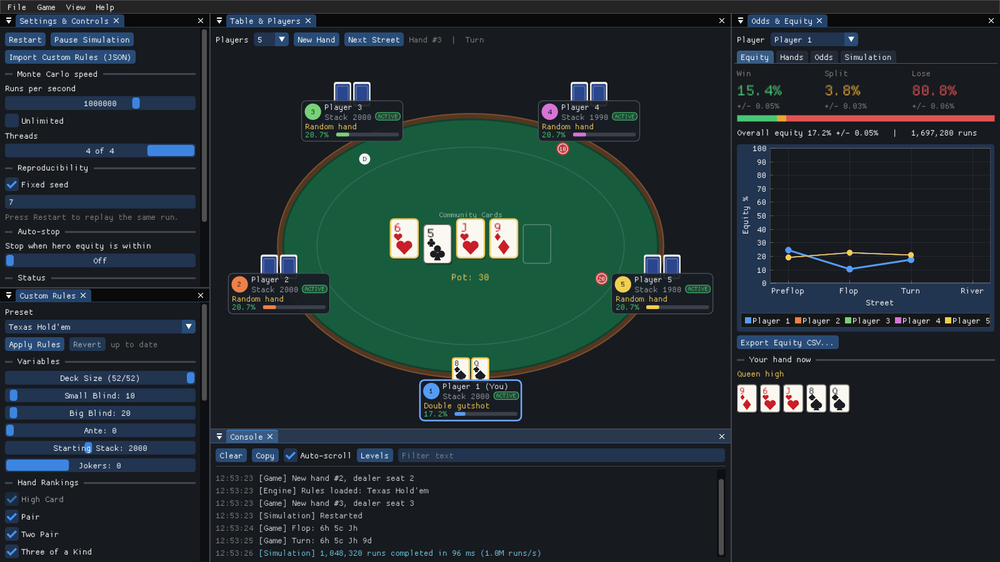
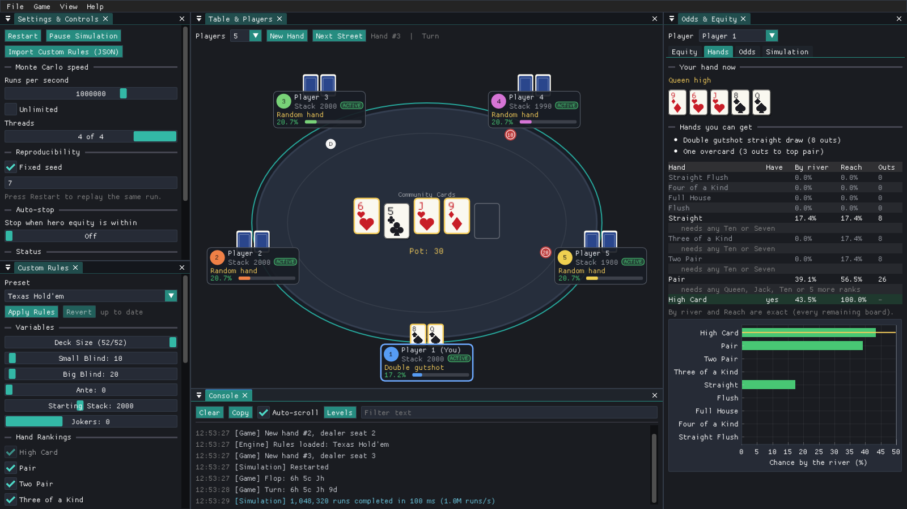

# PokerForge

Real-time poker odds for 2–6 players. A parallel Monte Carlo engine and an exact hand evaluator sit behind a dockable desktop UI, and the rules (deck size, hand rankings, wild cards, blinds, betting structure) are data you can change without recompiling.



<details><summary>Flat modern theme, Hands tab</summary>



</details>

## What it does

- **Live equity** (win / split / lose) for every player. When there are at most 10 million possible deals (for example heads-up from the flop on, or any spot where every hand is known), every deal is counted and the numbers are **exact**. Otherwise, such as preflop against unknown hands, they are **estimated** from random deals, shown with a ± margin, and the estimate **settles** by itself at ±0.05% so nothing keeps running. The window is never blocked either way.
- **Exact hand evaluation** for any rule set, including wild cards (deuces, jokers, one-eyed jacks), short deck and custom hand-ranking orders. About 50 million 7-card hands per second per core for standard rules.
- **Your hand and your outs**: the best hand you hold and the five cards that make it, the exact chance of finishing as each hand type once the flop is out, the cards that get you there ("any Ten or Seven"), and flush, straight, overcard and set draws.
- **Custom rules** edited live in the Rules panel (Apply / Revert), or loaded from JSON.
- **Pot-odds helper**, a 0–100% equity chart per street, a console, CSV export of the equity history, two themes, and a layout that is saved between runs.

Not in v1: online play, bots or solvers, other poker games than Hold'em, betting simulation. See [PROJECT_PLAN.md](PROJECT_PLAN.md) for the design, the decisions made and the backlog.

## Build, test and run

Needs a C++20 compiler (GCC 12+, Clang 15+, MSVC 2022), CMake 3.24+ and Ninja.

```
cmake --preset linux-release          # macos-release or windows-release on those systems
cmake --build --preset linux-release
ctest --preset linux-release
build/linux-release/pokerforge        # rules are copied next to the executable
```

- **Linux**: `sudo apt install libsdl2-dev libgl-dev` (Debian/Ubuntu). Without SDL2 installed, CMake fetches and builds it.
- **macOS**: `brew install libomp sdl2`, and add `-DOpenMP_ROOT=$(brew --prefix libomp)` when configuring (Apple Clang has no OpenMP of its own).
- **Windows**: a clean machine needs only CMake and Visual Studio 2022; SDL2 is fetched and built. Run the configure step from a "x64 Native Tools" prompt.
- **Headless core only** (no window): add `-DPF_BUILD_UI=OFF`. This builds the library and the tests without SDL2 or OpenGL.

Dear ImGui, ImPlot, nlohmann/json and (if needed) SDL2 are downloaded at pinned versions the first time you configure.

## Using it

The window has five panels that you can drag, tab and resize; **View ▸ Reset Layout** puts them back.

| Panel | What it does |
|---|---|
| Settings & Controls | **Controls**: restart, pause, import rules, whether to count every deal when possible, how precise an estimate must be before it settles, and a one-line status ("Exact: every one of 45,540 deals counted" or "Estimate settled, ±0.05%"). **Advanced**: speed of the random deals (1k to 20M per second, or unlimited), threads, fixed seed, statistics, benchmark |
| Custom Rules | Deck size, blinds, ante, stack, jokers, which hand types count and in what order, wild cards, betting structure with a raise preview, presets |
| Table & Players | The table. Click a seat to fold or rejoin; right-click for known or random cards and "set as hero". **New Hand** and **Next Street** deal and reveal |
| Odds & Equity | Equity readouts and chart, your hand and outs (Hands), pot odds (Odds), per-player results and how they were computed (Details) |
| Console | Everything the app did, filterable, with Copy and Clear |

Opponents start as **random hands**, so your equity is against a random holding. Mark a seat's cards as *known* in its right-click menu to see equity against those exact cards. On the river everyone turns their cards over and the winner is highlighted.

**Keyboard**: F1 shortcuts, F2 new hand, F3 next street, F4 pause or resume, F5 restart, Ctrl+O import rules, Ctrl+S export rules, Ctrl+E export equity CSV. You can also **drop a `.json` rules file onto the window**; it goes into the Rules panel as an unapplied draft.

**Where files go** (the per-user folder is `SDL_GetPrefPath`):

| System | Folder |
|---|---|
| Linux | `~/.local/share/PokerForge/PokerForge/` |
| macOS | `~/Library/Application Support/PokerForge/PokerForge/` |
| Windows | `%APPDATA%\PokerForge\PokerForge\` |

It holds `imgui.ini` (window layout), `settings.json` (theme, speed, threads, seed, precision, exact mode) and `exports/` (the default place for CSV exports). Rule presets are the JSON files in the `rules` folder next to the executable.

### Rules files

```json
{
  "name": "Short Deck (6+)",
  "deck": { "size": 36, "jokers": 0 },
  "wild": "none",
  "hand_rankings": {
    "order": ["high_card","pair","two_pair","straight","three_of_a_kind",
              "full_house","flush","four_of_a_kind","straight_flush"],
    "wheel_straight": true
  },
  "blinds": { "small": 10, "big": 20, "ante": 20 },
  "starting_stack": 2000,
  "betting": { "structure": "no_limit", "max_raises": 4 }
}
```

| Key | Values |
|---|---|
| `deck.size` | 24 to 52 in steps of 4 (36 = ranks 6 to Ace). Other values are rounded and a warning is shown |
| `deck.jokers` | 0 to 2 |
| `wild` | `none`, `deuces`, `jokers`, `one_eyed_jacks` (the J♠ and J♥) |
| `hand_rankings.order` | Weakest to strongest. Listed types are on, unlisted types are off, and a hand falls through to the best type that is on. `high_card` is always on; `five_of_a_kind` needs a wild card. Types: `high_card`, `pair`, `two_pair`, `three_of_a_kind`, `straight`, `flush`, `full_house`, `four_of_a_kind`, `straight_flush`, `five_of_a_kind` |
| `hand_rankings.wheel_straight` | Ace plays low (A-2-3-4-5, or A-6-7-8-9 in a 36-card deck) |
| `blinds`, `starting_stack` | Chips |
| `betting.structure` | `no_limit`, `pot_limit`, `fixed_limit`; `max_raises` applies to fixed-limit |

Anything missing takes the Hold'em default. Wrongly typed values are an error; unknown keys and out-of-range values only give a warning in the Console, and the rules are corrected.

A wild card can become any rank in the deck. For pairs through five of a kind it may copy a card you already hold; in a flush it fills the highest missing card of the suit; a spare wild plays as an ace.

## Command line

`pokerforge --help` lists everything. Most useful options are scripted, for tests and screenshots:

```
pokerforge --frames 120 --players 6 --advance 2 --seed 7 --tab 1 --theme flat \
           --fold 3,5 --press f3,ctrl+e --drop rules/short_deck_36.json \
           --screenshot shot.ppm        # runs unattended, then exits
```

`--tab` picks the Equity tab and `--settings-tab` the Settings tab. `--press` and `--drop` send real SDL events, so they test the same code paths as a keyboard and a file drag. Scripted runs never read or write your saved settings (unless you pass `--settings FILE`).

## How it is put together

```
src/core/    cards (bitboards), RNG, rules JSON, O(1) evaluator with wild cards, hand analysis, betting limits
src/engine/  Monte Carlo simulator + worker thread, table state, benchmark
src/ui/      AppState (UI-free), settings, CSV export, and the ImGui panels, dialogs and main loop
src/util/    thread-safe log
tests/       unit tests, a brute-force reference evaluator, exhaustive checks
rules/       the rule presets
```

The core library has no UI dependency. One thread owns the UI state and hands the simulation an immutable scenario; the simulation hands back snapshots. A fixed seed gives bit-identical results for any thread count.

## Verification

- `ctest --preset linux-release` runs 80+ unit tests in a few seconds.
- The evaluator is checked against a separate brute-force implementation (every 5-card subset, every wild substitution) on random hands and random rule sets, and against exact enumeration: all 133,784,560 seven-card hands and all 2,598,960 deuces-wild five-card hands. These are slow, so they run on demand: `ctest --preset linux-release -C Exhaustive -L exhaustive`.
- Simulated equity is checked against exact enumeration of every board, and the exact mode is checked deal for deal against independent brute-force loops (including three-way spots).
- Presets for sanitizers: `linux-asan` (address and undefined behaviour) and `linux-tsan` (threads; OpenMP is off there because its runtime is not instrumented).
- CI builds and tests on Linux, macOS and Windows, opens the real window on a virtual display on Linux, and produces a downloadable package for each system.

## Packaging

```
cmake --build build/linux-release --target package
```

makes `PokerForge-<version>-<system>-<arch>.tar.gz` (a `.zip` on Windows) holding the executable, the `rules` folder and this README, in one folder you can unpack anywhere. CI attaches these to every run.

- **Windows**: SDL2 is linked statically when it is fetched, and the MSVC OpenMP runtime comes with the Visual C++ Redistributable. If you built against a shared SDL2 instead, copy `SDL2.dll` next to the executable.
- **Linux**: needs `libSDL2` and OpenGL at run time (`apt install libsdl2-2.0-0`).
- **macOS**: needs the `libomp` and SDL2 dylibs (`brew install libomp sdl2`). An app bundle, a Windows installer and an AppImage are backlog item B6.
- The window is not marked high-DPI aware on Windows by a manifest yet; it scales fonts from the display DPI SDL reports.
